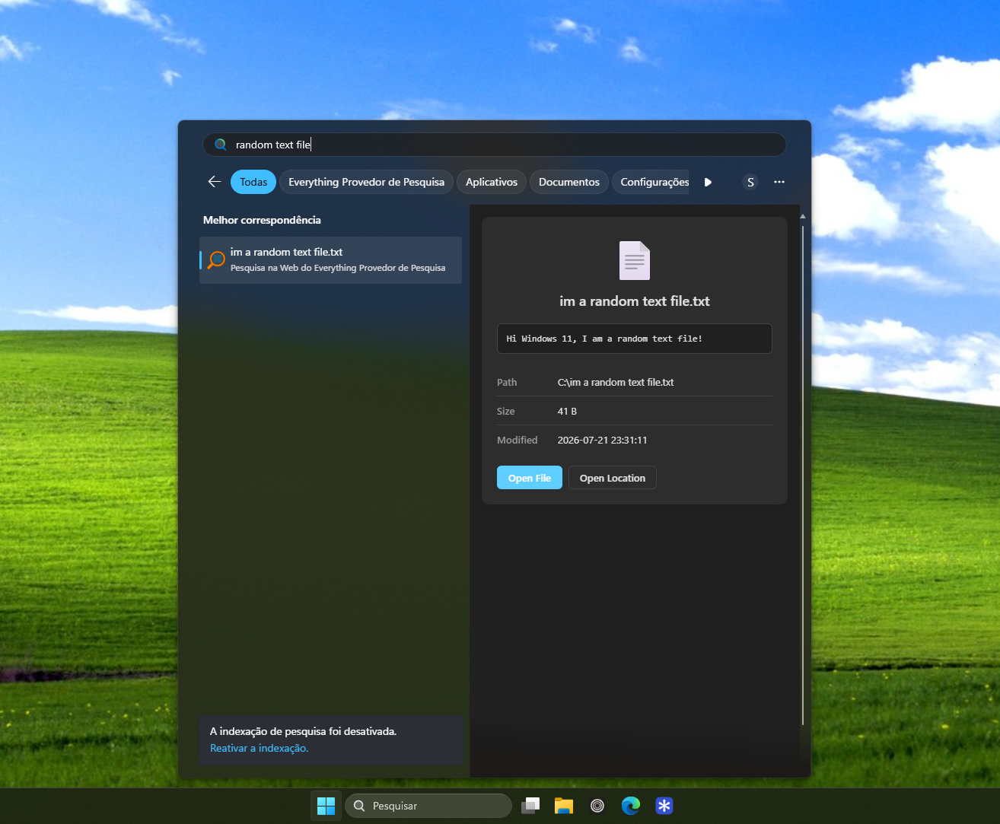

<p align="center">
  
</p>

<h1 align="center">Everything Search Provider for Windows 11</h1>

<p align="center">
  Proof of concept instant local file search right inside the native Windows 11 search bar (<code>Win + S</code>), powered by <strong>VoidTools Everything</strong>.
</p>

<p align="center">
  
</p>

---

## Features

- **Instant Search Results**: Routes search queries directly to **Everything** for very fast local file search.
- **Native Windows Integration**: Built using the official Windows 11 "Web Search Provider" extension APIs (EEA Digital Markets Act compliant).
- **Fully working Previews**: Complete preview pane with file metadata, video/audio playback, text file preview, and quick actions ("Open File" and "Open Location").
- **Multilingual Support**: Auto-detects system language with translations available for English, Spanish, and Brazilian Portuguese as a basis.

---

## Requirements

Before building and installing, ensure you have:

1. **[VoidTools Everything](https://www.voidtools.com/downloads/)** installed and running in the background.
2. **Windows 11** with **Developer Mode** enabled (*Settings > System > For developers > Developer Mode*) and EU compliance features enabled.
3. **[Go 1.21+](https://go.dev/dl/)** installed.
4. **[Windows SDK](https://developer.microsoft.com/en-us/windows/downloads/windows-sdk/)** (provides 'MakeAppx.exe' and 'SignTool.exe').

Note: If you're not from the EU, you can change your system's **Device setup region** to be one of the EU countries, and that should unlock all those features with no noticeable changes to your system, here's a quick video from [ThioJoe](https://www.youtube.com/watch?v=MfBNxGw_5J8) that explains how to do that.

---

## Quick setup

### 1. Install the server

Download ''EverythingSearchProvider.zip'' from Github releases and extract it somewhere.

### 2. Trust the certificates (First Time Only)

Windows 11 requires trusted certificates for both the MSIX installer and the local web search provider in order for them to work. 
Just double-click 'setup.bat' or right click and install the 'setup-cert.ps1' script directly (they need Admin permissions to work).

### 3. Install and run the server

Double click and install `EverythingSearch.msix`, and you should be good to go! Just start typing in the start menu or search bar and you should see results, as long as Everything is running.

Note: If you want to stop the server, just right click its shortcut in the start menu, and go to Settings and click Terminate
(or go to Windows Settings -> Apps -> Installed apps -> 3-dots next to `Everything Search Provider` -> Advanced Options -> Terminate

### 4. Enabling web search providers

To enable search providers, go to _Windows Settings_ -> _Privacy & Security_ -> _Search permissions_, enable _"Let search apps show results"_, and the switch for Everything.

---

## Building and testing the server

### 1. Build

Open PowerShell 7 ('pwsh.exe') as Administrator in the project directory and run:

```powershell
pwsh .\build.ps1
```

(Should work with Powershell 5 too ('powershell.exe'))

This script automatically compiles the Go binary, packages it into an MSIX installer ('EverythingSearch.msix'), and signs it with a self-signed developer certificate ('_signing.cer').

### 2. Generate and trust certificates (First Time Only)

Windows 11 requires trusted certificates for both the MSIX installer and the local web search provider in order for them to work. 
Just double-click ``setup.bat`` or the ``setup-cert.ps1`` script directly (they need Admin permissions to work).

### 3. Install and run the server

Install `EverythingSearch.msix` so it registers the search provider with the system, then you can terminate the server in settings, and just run the compiled `EverythingSearch.exe` if you want to quickly try changes without reinstalling it.

- If it doesn't work for some reason, check the logs at `%LOCALAPPDATA%\EverythingSearchProvider\server.log`
- Make sure to generate and trust the certificates in the previous step first, the server won't run without them.
- Use Task Manager if you need to stop it, just search for "Everything Search Provider"

---

## License

This project is licensed under the [MIT License](LICENSE).
The VoidTools Everything CLI ('es.exe') is bundled in accordance with VoidTools' [Everything License](https://www.voidtools.com/License.txt), also included with the project files.
